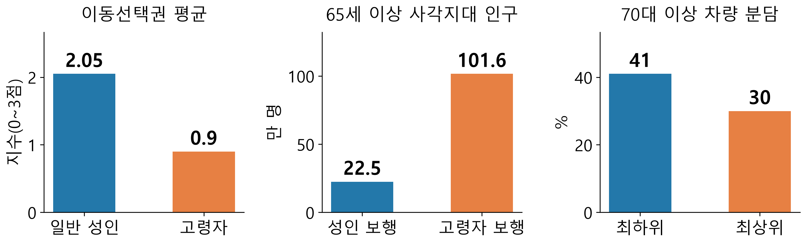
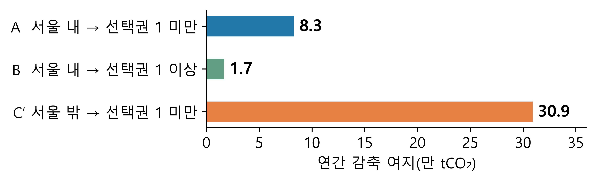
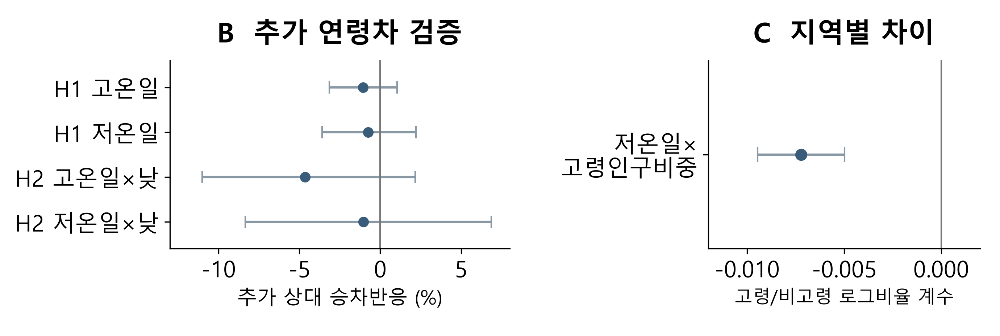

<p align="center">
  
</p>

# 서울 고령자의 이동선택권 격차와 행정동별 개선방안

집에서 교통수단까지의 **접근성과 연령별 이용 조건**을 살펴, 서울의 이동선택권 격차와 지역별 개선방안을 제안합니다.

지하철 무임승차와 버스 요금 지원이 있어도, 정류장까지 걷기 어렵거나 이용할 교통수단이 부족하면 실제 선택지는 달라집니다. 이 프로젝트는 교통수단의 공급, 실제 이용 양상, 날씨에 따른 승차반응과 탄소 감축 여지를 데이터로 살펴봅니다.

<p align="center">
  <a href="#핵심-결과"><strong>핵심 결과</strong></a> ·
  <a href="#지역에-맞는-정책-제안"><strong>정책 제안</strong></a> ·
  <a href="docs/results-guide.md"><strong>결과와 근거</strong></a> ·
  <a href="docs/reproduction.md"><strong>실행 방법</strong></a> ·
  <a href="docs/data-and-ai.md"><strong>데이터와 AI 활용</strong></a>
</p>

## 핵심 결과

| 관찰한 격차 | 확인된 결과 | 해석 범위 |
| --- | --- | --- |
| 같은 공급, 다른 접근성 | 고령자 조건에서 지수 1 미만 지역의 추정 고령인구 **101.6만 명, 약 52%** | 보행·이용 조건에 따른 공급 사전진단. 교통수단이 없다는 뜻은 아닙니다. |
| 접근성과 차량 이용 | 이동선택권 최하위/최상위 집단의 70대 이상 차량 분담 중앙값 **41% / 30%** | 동별 연관이며 노선 추가의 인과효과를 입증한 값은 아닙니다. |
| 지역별 탄소 감축 여지 | 이동 전환을 가정한 연간 **40.9만 tCO₂** | 시나리오 계산이며 추가 셔틀·DRT 배출을 차감한 순감축량은 아닙니다. |
| 날씨 반응의 지역 차이 | 2024년 지하철에서 **저온일 × 고령인구비중**의 음의 연관 확인 | 역 소재 행정동의 상대 승차반응에 관한 연관입니다. 분석 대상 역의 추가 연령차·주간 증폭 4개 검정은 지지되지 않았습니다. |

### 1. 공급이 같아도 실제 접근 조건은 다릅니다

이동선택권 지수는 지하철·버스·따릉이의 공급과 연령별 보행·이용 조건을 **0~3점**으로 나타냅니다. 동일한 65세 이상 인구에 성인 조건을 적용했을 때와 고령자 조건을 적용했을 때를 비교했습니다.

<p align="center"></p>

평균 지수는 **65세 이상 인구 가중평균**, 차량 분담은 **집단 내 동별 중앙값**입니다. 지수 1 미만은 본 분석의 진단 기준이며 실제 이동권 전체를 측정하지는 않습니다. 기본값을 포함한 14개 조건의 민감도 점검과 대안 기준도 확인했습니다.

[지수·사각지대 근거](outputs/tables/b_summary.json) · [동별 지수](outputs/tables/b0_dong_mci_all.csv) · [차량 이용 비교](outputs/tables/a1_mci_quartiles.csv)

### 2. 탄소 감축 대상지는 서울 밖 유입까지 살펴야 합니다

서울 도착 자가용 이동의 연간 추정 배출량은 **429만 tCO₂**이며, 배출량의 **76%가 서울 밖 출발**에서 발생했습니다. 출발지·거리대와 도착지 접근성을 나누어 승용차 이동 전환의 여지를 계산했습니다.

<p align="center"></p>

합계 **A+B+C′=40.9만 tCO₂**입니다. C′는 서울 밖에서 지수 1 미만 동으로 들어오는 이동의 차량 분담을 같은 거리대의 지수 1 이상 동 수준으로 낮추는 상한 시나리오입니다. C′ 감축 여지의 약 **52%(16.2만 tCO₂)**가 상위 50개 동에 집중됐습니다. 실제 성과는 감소한 승용차 배출에서 추가 운행 배출을 뺀 순탄소효과로 평가해야 합니다.

[탄소 시나리오 표](outputs/tables/m3_carbon_levers.csv) · [도착지·시간대 결과](outputs/tables/n_summary.json) · [계산 코드](scripts/24_destination_access.py)

### 3. 날씨 반응은 분석 대상 역의 평균과 지역별 차이를 구분합니다

2024년 서울 지하철 **243개 역**을 대상으로 연령별 반응을 검증하고, 역이 위치한 **173개 행정동**의 맥락에 따른 차이를 분석했습니다.

<p align="center"></p>

- **분석 대상 역의 연령차:** 고온·저온일의 고령자 추가 승차 변화와 10~16시 증폭은 Holm 보정 후 4개 검정 모두 지지되지 않았습니다. 차이가 없다는 증명은 아닙니다.
- **지역별 상대반응:** 고령인구비중이 높은 동에 위치한 역일수록 저온일의 고령/비고령 승차 로그비율 반응이 더 음의 방향이었습니다(고령인구비중 1표준편차 약 4.23%p당 β=−0.007220, 개별 95% CI [−0.009456, −0.004985], Holm 보정 후 유의).
- **확인 범위:** 개인의 절대 외출 감소나 정책 효과를 직접 추정하지 않습니다. 상·하위 5% 기온을 사용한 지역별 민감도 검정은 공분산 문제로 추론할 수 없어 강건성 근거에서 제외했습니다.

[연령차 검정](subway/results/models/confirmatory_test_family.csv) · [지역별 검정](subway/results/models/spatial_moderation_primary.csv) · [해석과 정책 시사점](subway/docs/analysis/12-evidence-synthesis-policy.md)

## 지역에 맞는 정책 제안

**지역의 필요를 진단하고, 지원의 순서를 정합니다.** 이동선택권과 차량 분담을 함께 진단해 지역별 지원 순서를 제안합니다.

| 정책 유형 | 동 수 | 우선 검토할 처방 |
| --- | ---: | --- |
| 공급 먼저 | 180 | 버스 노선·정류장·환승거점과 보행 연결 개선 |
| 이동권 우선 | 78 | 전화 호출·동행 지원과 생활·의료시설 접근 보완 |
| 수요관리 가능 | 51 | 대체수단 이용 여건을 점검한 뒤 주차·차량 수요관리 |
| 유지 | 118 | 서비스 유지와 정기 점검 |

지수 **1점**, 차량 분담 **약 42%**를 분석용 판별 기준으로 사용했습니다. 법정 기준이나 효과가 검증된 경계값은 아닙니다. 대형 시설 연계 공동셔틀·DRT·보행 개선을 검토하고, 시범운행의 접근성·이용량·운영비·순탄소효과로 실제 개선을 평가하도록 제안합니다.

[동별 정책 판별](outputs/tables/f2_dong_quadrant.csv) · [판별 코드](scripts/16_policy_diagnosis.py) · [정책 대상지 분석](outputs/tables/n6_policy_targets.csv)

<details>
<summary><strong>분석 대상과 자료 기간</strong></summary>

| 분석 | 범위와 기준 |
| --- | --- |
| 이동선택권 | 서울 거주 가능 100m 격자 38,952개, 2026년 자료 기반. 고령자 접근 조건은 65세 이상 기준 |
| 실제 이동 | 2026년 9월 KT 생활이동. 고령자 이동은 70대 이상 자료로 접근성의 연령 기준과 구분 |
| 탄소·광역 유입 | 서울 밖 출발을 포함한 전 연령 서울 도착 이동. 2026년 9월 평일 5일 평균을 평일 250일로 연간화 |
| 지하철 날씨 심층검증 | 2024년 서울 243역·366일, 지역 맥락은 역 소재 173동. 고령권종과 비고령 승차 비교 |

각 결과는 대상·기간·단위가 다릅니다. 자세한 정의와 산출물은 [결과 안내](docs/results-guide.md)를 참고하세요.

</details>

## 분석 과정

**데이터 출처 기록 → 전처리·품질 검증 → 접근성·이용 분석 → 통계 검증 → 지역별 정책 진단**

| 과정 | 방법 | 코드·기록 |
| --- | --- | --- |
| 공급과 접근성 | 100m 격자, 연령별 보행·이용 조건, 공간 집계 | [지수 산정](scripts/02_build_index.py) |
| 이용과 지역 차이 | 회귀, 공간 보정, 매칭, 민감도 점검 | [식별 점검](scripts/20_identification.py) |
| 지역 유형·예측 요인 | K-평균, 랜덤포레스트 5겹 교차검증, SHAP | [군집](scripts/09_cluster.py) · [이용 모형](scripts/07_model_usage.py) |
| 날씨 반응 검증 | PPML, 역·날짜 고정효과, 군집 공분산, Holm 보정 | [연령차](subway/run_confirmatory.py) · [지역별 차이](subway/run_spatial_heterogeneity.py) |
| 탄소·정책 시나리오 | 거리대·출발지·도착지 분해, 이동 전환 가정 | [탄소](scripts/23_carbon_levers.py) · [도착지](scripts/24_destination_access.py) |

## 결과 확인과 재현

| 목적 | 바로가기 |
| --- | --- |
| 실행 없이 핵심 결과 읽기 | [결과와 근거 안내](docs/results-guide.md) |
| 가공 자료로 일부 단계 실행 | [빠른 실행과 환경 설정](docs/reproduction.md#가공-자료로-빠른-실행) |
| 원본부터 분석 실행 | [전체 실행과 지하철 실행](docs/reproduction.md) |
| 데이터 출처·AI 활용 확인 | [데이터와 AI 활용](docs/data-and-ai.md) |
| 검증한 범위 확인 | [검증 기록](docs/validation.md) |

**확인된 검증:** 원본 자료가 있는 데스크탑에서 지하철 테스트 **195개 통과**(2026-10-17). 가공 자료를 이용한 빠른 실행 6단계와 탄소·정책·비용 3단계의 결과 표 10개 값 일치를 확인했습니다. 이 기록은 원본부터 모든 분석을 다시 실행했다는 뜻은 아닙니다.

## 저장소 구조

```text
README.md           프로젝트 소개와 핵심 결과
run_all.py          전체 분석의 단계별 실행
scripts/            접근성·이용·탄소·정책 분석 코드
data/               출처 manifest와 가공 자료
outputs/            결과 표와 그림
subway/             지하철 전처리·날씨 반응 검증
notebooks/          빠른 실행 노트북
docs/               결과·재현·데이터·검증 안내
```

## 팀

**덜컹덜컹 서울버숭**

| 참여자 | 주요 기여 |
| --- | --- |
| [유승민 · s-min04](https://github.com/s-min04) | 이동선택권 지수, 차량 이용·탄소 분석, 지역별 정책 진단 |
| [이일우 · ilwoo-maker](https://github.com/ilwoo-maker) | 지하철 전처리·날씨 확증검정·지역별 이질성 분석, 근거 검토와 보고서 정리 |

AI는 자료 처리·코드 작성·분석 검토·시각화에 활용했고, 분석 기준과 해석은 사람이 검토했습니다. [AI 활용 범위와 주요 지시](docs/data-and-ai.md#ai-활용)
